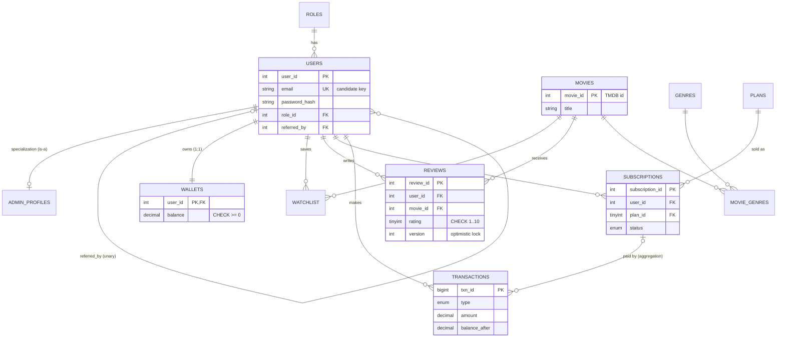
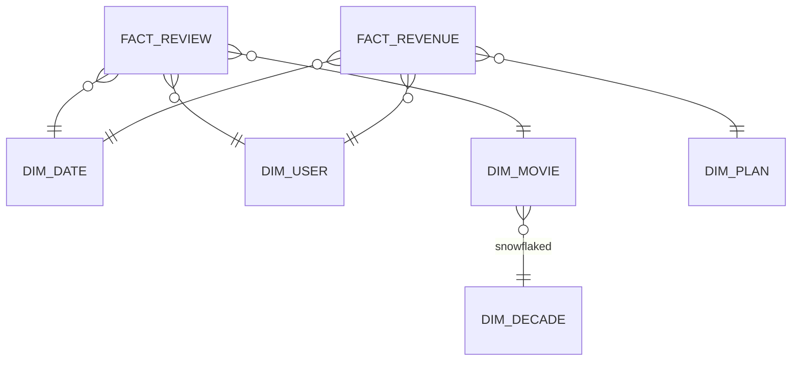

# ER Diagram — AJ Cinema

Renders on GitHub / VS Code (Mermaid). For **dbdiagram.io**, paste `schema.dbml`. For **Lucidchart**, import the DBML/SQL (`server/sql/01_schema.sql`).

## ER concepts used (Unit 1)

| Concept | Where |
|---|---|
| **Entity / weak-ish entity** | `users`, `movies`, `plans`; `wallets` depends on `users` |
| **Relationships** 1:1, 1:N, M:N | `users–wallets` (1:1), `users–reviews` (1:N), `movies–genres` via `movie_genres` and `users–movies` via `watchlist` (M:N) |
| **Unary (recursive)** | `users.referred_by → users.user_id` |
| **Generalization / Specialization** | `USER` is the super-type; `ADMIN_PROFILES` is the sub-type (table-per-subtype), plus role-based specialization via `roles` |
| **Aggregation** | The relationship *USER buys PLAN* is promoted to the entity `SUBSCRIPTION`, which then participates in its own relationship with `TRANSACTION` |

## Star & snowflake (analytics)

*Star:* facts surrounded by denormalised dimensions → few joins, fast aggregation.
*Snowflake:* `dim_movie → dim_decade` is normalised into its own table (less redundancy, one extra join).
